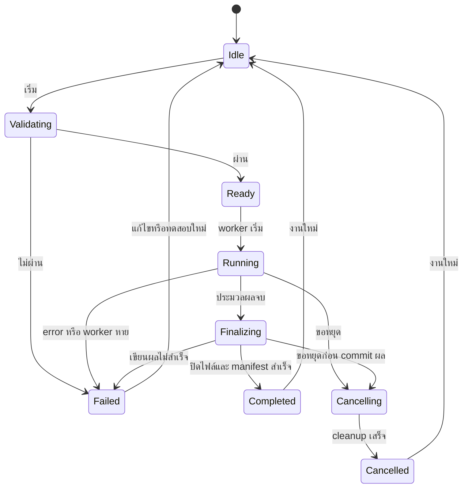

# แบบ GUI และตัวเปิดทดสอบบน Windows

สถานะ: **ร่างออกแบบเพื่อทบทวนก่อนลงมือเขียน GUI/launcher**  
วันที่: 10 ตุลาคม 2026  
ฐานโค้ด: PR #1, commit `984c773f86fb646db170b47841afe54acc8b5ce9`  
เทคโนโลยีที่เสนอ: Python + PySide6 Widgets; pipeline ทำงานใน process แยก

## 1. ผลลัพธ์ที่ต้องการ

ผู้ทดสอบบน Windows เปิดโปรแกรม → กดทดสอบตัวอย่าง → เห็นความคืบหน้า →
เห็นสรุปผลและภาพตรวจสอบ → เปิดโฟลเดอร์ผลลัพธ์ได้ โดยไม่ต้องใช้คำสั่ง CLI ระหว่างใช้งาน

สำหรับวิดีโอจริง: เปิด/สร้าง site → เลือกวิดีโอและเวลาเริ่ม → เลือก calibration และ
โมเดลที่อยู่ในเครื่อง → วาดเส้นนับ → ตรวจความพร้อม → ประมวลผล → ตรวจผล

รุ่นแรกเป็นเครื่องมือทดสอบ pipeline จุดเดียว มีป้ายระบุวิธีประมวลผลและข้อจำกัด
ความแม่นยำ ไม่มีการนำค่าที่ pipeline ยังไม่คำนวณมาแสดงเป็นผลสำเร็จ

### ขอบเขตรุ่น GUI Test 0.1

| ทำในรุ่นแรก | งานต่อยอด |
|---|---|
| เปิดและบันทึก site config แบบ Foundation | รัน project หลาย site พร้อมกัน |
| สร้าง/รัน synthetic demo จากหน้าจอ | Re-ID, human review ข้ามกล้อง |
| วิดีโอจริง + local YOLO model บน CPU | TensorRT, NVDEC และ GPU auto-tuning |
| นำเข้า planar homography; แสดงภาพกับพิกัดพื้น | full camera calibration, distortion และหลาย ground planes |
| วาด/แก้เส้นนับ; ตรวจข้อมูลก่อนรัน | lane/zone editor และ Frenet/headway |
| Progress, log, ยกเลิกงาน, ประวัติผล | pause/resume และ job queue หลายงาน |
| สรุป Parquet, ตาราง, ภาพ overlay และ CSV พื้นฐาน | micro/macro estimation และ simulator exporters |
| ตัวเปิดจากซอร์สและ portable Windows test build | ตัวติดตั้ง production และระบบอัปเดต |

OD zones ที่ runtime ยังไม่รองรับต้องแจ้งก่อนเริ่ม ไม่ตัดทิ้งเงียบ ๆ;
config แบบ full SPEC ต้องบอกความแตกต่างและไม่บันทึกทับด้วย schema รุ่น Foundation

## 2. สถานะที่มีและช่องว่าง

| ส่วน | สถานะฐานโค้ด | สิ่งที่จะเพิ่มก่อนใช้ใน GUI |
|---|---|---|
| CLI | validate / run / demo | `gui`, worker mode, JSONL events และ diagnostics |
| Config | site/project schema และ path validation | แยก schema validation ออกจาก resource preflight เพื่อแก้ฟอร์มได้แม้ไฟล์ยังไม่พร้อม |
| Pipeline | run แบบ synchronous; stdout รายงานตอนจบ | progress callback, cooperative cancellation และ event adapter |
| Manifest | running/completed/failed | cancelled, stage, heartbeat และ schema ของเหตุการณ์ |
| Results | Parquet + resolved config + manifest | reader ที่ตรวจ manifest/schema และอ่านข้อมูลเป็นหน้า |
| ภาพตรวจผล | ยังไม่มี | video preview, bbox/track/เส้นนับ overlay ตามเฟรม |
| Windows | ยังไม่ได้ผ่าน matrix ครบ | CI ไม่ยกเลิกงานอื่นเพราะ artifact quota และ smoke test ของ GUI/build |

ค่าเดิม `schema_version=1-foundation` ของข้อมูลยังใช้ต่อ;
progress/cancel API ต้องไม่ทำให้ผู้ใช้ `tbs run` เดิมเปลี่ยนคำสั่ง

## 3. รูปแบบหน้าต่าง

หน้าต่างเริ่มต้น 1280×800 logical pixels; ใช้งานขั้นต่ำที่ 1024×720 โดยเลื่อนเนื้อหาได้
ทดสอบ scaling 100%, 125%, 150%, 200% และการย้ายหน้าต่างข้ามจอ

ใช้ PySide6 Widgets และ system font ที่อ่านไทยได้ (เช่น Segoe UI ตามเครื่อง)
โหมดสว่างก่อน: พื้นหลังเทาอ่อน, พื้นเนื้อหาขาว, ปุ่มหลักสีน้ำเงิน, สถานะเขียว/ส้ม/แดง
ทุกสถานะมีข้อความและสัญลักษณ์ร่วมกับสี; focus และการกด Tab ต้องเห็นชัด
ภาษาไทยเริ่มต้น มีโครง translation สำหรับอังกฤษ โดยไม่ฝังข้อความใน controller

| พื้นที่ | ขนาด/ตำแหน่ง | เนื้อหา |
|---|---|---|
| แถบบน | สูงประมาณ 56 px | ชื่อโปรแกรม, site ปัจจุบัน, ปุ่มเปิด/บันทึก |
| Navigation | ด้านซ้ายประมาณ 200 px | เริ่มต้น / ตั้งค่าจุดสำรวจ / ประมวลผล / ผลลัพธ์ |
| Main content | ขยายตามหน้าต่าง | ฟอร์ม, preview, progress หรือผลลัพธ์ |
| Status bar | ด้านล่างประมาณ 28 px | งานที่กำลังทำ, backend/device, สถานะ config |

หน่วยปรากฏข้างค่าทุกครั้ง: เมตร, วินาที, กม./ชม.; ข้อมูลภายในยังใช้ SI ตาม schema
เวลาในฟอร์มแสดง timezone ชัดเจน ค่าเริ่มต้น Asia/Bangkok (+07:00);
เวลา PTS และเวลาผนังกล้องแสดงคนละช่อง ป้องกันตีความผิด

## 4. หน้าจอและพฤติกรรม

### 4.1 เริ่มต้น

องค์ประกอบ: ปุ่มใหญ่ “ทดสอบตัวอย่าง”, “เปิดจุดสำรวจ”, “สร้างจุดสำรวจ”;
รายการไฟล์ล่าสุดไม่เกิน 10 รายการ; ส่วนตรวจ environment และเลือกที่เก็บผลลัพธ์

“ทดสอบตัวอย่าง” สร้าง fixture ในโฟลเดอร์ที่เขียนได้และเปิดหน้า Run;
สำเร็จแล้วแสดง 50 frames, 1 track, 1 crossing พร้อมผล benchmark
และป้าย “ข้อมูลจำลองสำหรับทดสอบระบบ”

ถ้าโมเดลจริงยังไม่พร้อม ผู้ใช้ยังทดสอบ demo ได้;
ถ้า dependency สำคัญหาย ให้แสดงชื่อที่ขาดและปุ่มคัดลอก diagnostics

### 4.2 ตั้งค่าจุดสำรวจ

แบ่งเป็นแท็บ **วิดีโอ / กล้อง / เส้นนับ / โมเดลและตัวเลือก** พร้อม preview ด้านขวา
และสรุป validation ที่ด้านล่าง

| แท็บ | ฟิลด์/เครื่องมือ | การตรวจ |
|---|---|---|
| วิดีโอ | site_id, playlist, start_time ต่อคลิป, epoch; เพิ่ม/ลบ/จัดลำดับ | ไฟล์มีจริง, decode ได้, timezone ครบ, เวลาไม่ทับซ้อน |
| กล้อง | เปิด camera YAML, ดู matrix และภาพบนพิกัดพื้น | matrix finite/invertible; ยืนยัน input เป็นภาพที่ undistort แล้ว |
| เส้นนับ | เพิ่ม line ID, คลิกสองจุดบนภาพ, ลาก endpoint, ลบ, ย้อนการแก้ล่าสุด | ไม่เป็นเส้นศูนย์ความยาว, ID ไม่ซ้ำ, ฉายไปพื้นได้ |
| โมเดล | เลือก local weights, confidence, class IDs, CPU | ไฟล์อ่านได้, dependency พร้อม, model-load preflight |
| ตัวเลือกขั้นสูง | tracking distance/gap, resample interval, interpolation gap | ค่าบวก/ช่วงตาม schema; มี tooltip และ reset defaults |

การวาดเส้น: เก็บ mouse coordinates เป็นพิกเซลภาพจริง ไม่ใช่พิกเซลหน้าจอ;
ชดเชย zoom/pan/letterbox ก่อนฉายด้วย homography; บันทึก p1/p2 เป็นเมตรตาม config
แสดงลูกศร p1→p2 และทิศการนับ +/− บนภาพ; preview ส่งกลับด้วย inverse homography
หาก denominator ใกล้ศูนย์หรือพิกัดไม่ finite ให้ปฏิเสธตำแหน่งนั้น

Calibration ระยะแรกเป็นการนำเข้า ไม่สร้าง matrix สมมติให้วิดีโอจริง;
ต้องแสดง “ยังไม่มีผลตรวจความแม่นยำ calibration” หากไม่มีหลักฐานแนบ
เครื่องมือ fit homography จากจุดภาคสนามเป็นงานแยก: ใช้ ≥4 จุดไม่อยู่แนวเดียวกัน
และจุด hold-out อิสระสำหรับวัด error; ไม่ใช้ fit residual เป็นหลักฐานความแม่นยำ

บันทึก config แบบ atomic ผ่าน temporary file และ replace;
path ที่ relativize ได้บันทึก relative ต่อ site YAML, ข้าม drive ใช้ absolute
config ที่มี field รุ่นอนาคตต้องเปิดแบบอ่านอย่างเดียวหรือรายงานไม่รองรับ;
ไม่ลบ field ที่ UI ไม่เข้าใจเมื่อบันทึก

### 4.3 ประมวลผล

ด้านบนแสดง site, จำนวนคลิป, backend/device และ output path;
ส่วนกลางมี stage, progress, elapsed time และ counters;
ด้านล่างมี log ที่พับได้กับปุ่ม “เริ่ม”, “ยกเลิก”, “เปิดโฟลเดอร์”

ก่อนเริ่ม ทำ preflight: config, แหล่งข้อมูล, โมเดล, calibration, output writable
และพื้นที่ว่างตามเกณฑ์ที่ผู้ใช้เห็น (การประมาณพื้นที่ไม่ใช่การรับประกัน)
ระหว่างรันล็อก config และปุ่มเริ่ม แต่ navigation/history ยังใช้ได้
แต่ละ run ใช้ snapshot ของ config และ run_id ใหม่ ไม่อ้างฟอร์มที่แก้ภายหลัง

| Stage | Progress ที่แสดง |
|---|---|
| ตรวจความพร้อม/โหลดโมเดล | indeterminate + ข้อความงาน |
| Decode/detect/track | frame/time counters; % เฉพาะเมื่อ total เชื่อถือได้ |
| Reconstruct/count | vehicles_done / vehicles_total |
| เขียนผล/ปิดไฟล์ | indeterminate |
| Completed | 100% เมื่อ writers ปิดและ manifest completed แล้ว |

ไม่รวมเปอร์เซ็นต์หลาย stage ด้วยน้ำหนักที่เดาขึ้นมา;
ETA แสดงเมื่อมีข้อมูลเพียงพอและระบุว่าเป็นประมาณการ
log จำกัดบรรทัดในหน้าจอ เช่น 2,000 บรรทัด แต่บันทึกไฟล์เต็มแบบหมุนขนาดได้

### 4.4 ผลลัพธ์

เลือก run จากรายการที่ผู้ใช้เปิด/รันเอง; แสดงสถานะ, site, เวลา, config/model hashes
และวิธีประมวลผลก่อนแสดงค่าผลลัพธ์

| ส่วน | เนื้อหา |
|---|---|
| Summary cards | decoded frames, tracks, crossing events, elapsed time |
| ตารางการนับ | line_id × direction × class_id; join vehicles ด้วย vehicle_id ภายใน run |
| ตารางรถ | vehicle_id, class, t_first/t_last และจำนวน samples |
| Video review | play/pause, seek, speed, bbox/track ID/line toggle |
| Trajectory review | trajectory ของรถที่เลือก; ความเร็วพร้อมหน่วย; observed/interpolated ต่างรูปแบบ |
| Diagnostics | manifest warnings, log และสำเนา resolved config |

เริ่ม preview/overlay หลังจบงาน ไม่ส่งภาพทุกเฟรมผ่าน stdout ของ worker;
decoder preview ทำงานเบื้องหลัง มี queue จำกัด และทิ้งผล seek เก่าด้วย request ID
วิดีโอที่เวลาห่างไม่สม่ำเสมอ sync ด้วย `(clip_index, t_video)` และ frame_index
ไม่ใช้ `frame_index / FPS` ในการเชื่อมภาพกับผล
ข้อมูล Parquet โหลดเฉพาะคอลัมน์/ช่วงที่ต้องใช้ และใช้ pagination

field ที่ยังไม่รองรับ เช่น lane/headway/quality แสดง “ยังไม่คำนวณ”;
ไม่แสดง -1/null เป็นค่าการวัด ตาราง class ใช้ ID เดิมจนมี mapping ที่ผู้ใช้กำหนด
คำว่า track และ crossing event ต้องไม่ถูกอ้างว่าเป็นจำนวนรถจริงที่ผ่านการตรวจแล้ว

CSV ขั้นต้น: `counts.csv`, `vehicles.csv`, `trajectories.csv` พร้อม manifest อ้างอิง;
ใช้ UTF-8 BOM สำหรับเปิดใน Excel บน Windows, headers ระบุหน่วย,
ระบุ epoch/site/run_id และข้อมูล missing อย่างสม่ำเสมอ
export เป็นการสร้างไฟล์ใหม่ ให้เลือกปลายทางและยืนยันเมื่อจะทับไฟล์เดิม

Failed/cancelled run แสดง diagnostics และป้าย “ผลบางส่วน”;
ปิดการ export ผลวิเคราะห์จน manifest completed หรือเปิดโหมดตรวจ debug ที่ระบุชัด

## 5. State และการยกเลิก



ยกเลิกแบบ cooperative ผ่าน control file ที่ผูก run_id/session และไม่ซ้ำกัน;
ตรวจ cancel ก่อนเริ่มแต่ละ stage, หลังแต่ละเฟรม, ต่อรถที่ reconstruct
และก่อนเปลี่ยน manifest เป็น completed; ใช้ `CancelledError` แยกจาก processing error
exit code worker: 0=completed, 2=failed, 3=cancelled (รวมเป็น CLI contract ใหม่)

เมื่อ model inference ยังไม่คืน control ให้แสดง “กำลังรอขั้นปัจจุบันหยุด”;
หลัง timeout แสดงทางเลือก force-stop พร้อมบอกว่าจะได้ผลบางส่วน
อย่าเรียก `terminate()` เป็นวิธี cooperative หลักบน Windows
ถ้า worker ถูก kill/crash ให้ parent ตรวจ exit code และ heartbeat;
manifest ที่ยัง running ไม่ถือว่า completed และต้องถูกระบุ interrupted เมื่อเปิดใหม่

ปิดหน้าต่างขณะรัน: กล่องเลือก “รอให้งานจบ”, “หยุดและปิด”, “กลับไปทำงาน”;
งานเบื้องหลังหลังปิด GUI เป็นขอบเขตถัดไป เพื่อไม่ให้มี worker orphan

## 6. สถาปัตยกรรม GUI–worker

GUI ใช้ QProcess เปิด Python worker ด้วย argument list และ absolute executable path;
อ่าน stdout/stderr แบบ asynchronous ผ่าน signals ไม่บล็อก Qt event loop
ไม่ใช้ shell interpolation สำหรับ path หรือคำสั่งที่ผู้ใช้กรอก

แยก validation logic, pipeline และ result reader จาก Widgets;
GUI ทำหน้าที่แสดง state/ส่งคำขอ ไม่คัดลอกอัลกอริทึมประมวลผลไปไว้ในหน้าจอ

| ส่วน | ความรับผิดชอบ |
|---|---|
| MainWindow / pages | ฟอร์ม, navigation, preview และสถานะ |
| SiteDocument | config draft, dirty state, validation errors และ atomic save |
| JobController | state machine, QProcess, control file, exit reconciliation |
| Worker adapter | เรียก pipeline, events, cancel และ log |
| ResultStore | ตรวจ schema/manifest, summaries, pagination และ CSV |
| PreviewService | decode/seek แบบ bounded queue; overlay ตาม PTS |
| AppPaths/Diagnostics | settings, log, output และรายงาน environment |

### Event contract

stdout ของ worker mode เป็น JSONL UTF-8 เท่านั้น; human/model logs ไป stderr;
parser เก็บ partial chunks จน newline, กำหนดขนาดบรรทัดสูงสุดและตรวจ event version
CLI mode เดิมยังพิมพ์ summary แบบเดิม ไม่บังคับผู้ใช้เดิมรับ JSONL

```json
{"event_version":1,"type":"progress","session_id":"...","run_id":"...","stage":"decode_track","frames_done":128,"frames_total":null,"detections":96,"elapsed_s":8.2}
```

ประเภท event: started / stage / progress / warning / completed / cancelled / failed
progress ไม่เกิน 5 events/s และมี heartbeat เมื่อ stage นาน;
timestamp ที่บอก elapsed ใช้ monotonic clock
completed event ส่งหลังปิด Parquet และบันทึก manifest completed สำเร็จ;
parent ต้องยืนยัน exit code และ manifest อีกครั้ง ไม่เชื่อ progress=100 อย่างเดียว
events ไม่บรรทุกภาพ, trajectories เต็มชุด หรือ secrets

เพิ่ม optional arguments ใน `run()` เช่น on_progress และ should_cancel;
defaults คงการใช้งานเดิม ทดสอบ CLI เก่าและ GUI worker ด้วย fixture เดียวกัน
cancel ก่อน run_id เกิด ใช้ session state; เมื่อมี run_id แล้วส่ง started event
output folder และ control/log files ต้องผูกกับ session เพื่อไม่ยกเลิกข้ามงาน

### โครงสร้างไฟล์ที่เสนอ (ยังไม่สร้าง implementation)

| Path | งาน |
|---|---|
| `python/tbs/gui/app.py`, `main_window.py` | entry point และ navigation |
| `python/tbs/gui/pages/` | start, site setup, run, results |
| `python/tbs/gui/job_controller.py` | QProcess และ event/state handling |
| `python/tbs/gui/site_document.py` | draft config / save / errors |
| `python/tbs/gui/preview.py` | video/geometry overlay |
| `python/tbs/gui/result_store.py` | Parquet/CSV access |
| `python/tbs/worker.py`, `events.py` | worker protocol และ cancellation |
| `python/tbs/app_paths.py`, `diagnostics.py` | filesystem/settings/runtime probes |
| `tools/windows/` | bootstrap, launch และ packaging |
| `tests/test_worker.py`, `tests/test_gui.py` | contract/integration/UI smoke |

## 7. ตัวเปิด Windows

### 7.1 ตัวเปิดจากซอร์สสำหรับรอบพัฒนา

ส่งมอบ `Setup-Windows.cmd`, `Launch-TBS.cmd`, `Launch-TBS-Debug.cmd`
และ `Test-Windows.cmd` ที่ root ของชุดทดสอบ พร้อมคู่มือไทย
ใช้ Python 3.12 x64 เป็น environment อ้างอิงสำหรับ launcher;
package support Python 3.10 เดิมยังคงตรวจใน CI แต่ไม่จำเป็นต้องมีหลายเวอร์ชันเพื่อทดสอบ GUI

| ตัวเปิด | พฤติกรรม |
|---|---|
| Setup-Windows.cmd | หา Python ผ่าน py launcher/explicit path, ตรวจเวอร์ชันและ 64-bit, สร้าง venv แล้วติดตั้ง GUI/base dependencies ตามชุดที่ทดสอบ |
| Launch-TBS.cmd | ตรวจ installation marker/dependencies แบบเร็ว แล้วเปิด GUI; ไม่เรียก pip ทุกครั้ง |
| Launch-TBS-Debug.cmd | เปิดพร้อม console/log เพื่อวินิจฉัยปัญหา |
| Test-Windows.cmd | รัน diagnostics และ synthetic benchmark; สรุป PASS/FAIL พร้อม path log |

Setup ใช้อินเทอร์เน็ตสำหรับ dependency ครั้งแรก;
รุ่น demo ติดตั้ง base+gui, โมเดลจริงใช้ detection profile พร้อม dependency CPU
ไม่ดาวน์โหลด weights อัตโนมัติ ให้ผู้ใช้เลือก weights ที่มีสิทธิ์ใช้งานในเครื่อง
หาก Python ไม่มี ให้แจ้ง requirement และวิธีติดตั้ง; ไม่ติดตั้ง Python หรือยกระดับสิทธิ์เงียบ ๆ

ใช้ `%~dp0` ระบุตำแหน่ง launcher, quote path ทุกจุด,
ส่ง user paths ผ่าน argument list ใน Python; ไม่เปลี่ยน PowerShell execution policy
venv/cache ใช้โฟลเดอร์ที่เขียนได้ใน LOCALAPPDATA แยกตาม build ID;
เส้นทาง source เปลี่ยนให้ตรวจ marker และสร้าง environment ใหม่เมื่อจำเป็น
Setup ที่ถูกขัดจังหวะต้องไม่สร้าง marker สำเร็จ; มี repair/reset environment ชัดเจน

เส้นทางข้อมูลผู้ใช้ใช้ LOCALAPPDATA/TrafficBehaviorSuite สำหรับ settings/log/cache;
output เริ่มต้นในโฟลเดอร์ผู้ใช้ที่เขียนได้ และเลือกเปลี่ยนได้จากหน้าเริ่มต้น
แยก mutable data จาก source/install directory; ไม่เขียนลง Program Files

### 7.2 Portable .exe สำหรับเครื่องทดสอบ

หลัง source launcher ผ่าน ให้สร้าง **one-folder portable build** ด้วย PyInstaller
บน Windows runner แล้วส่ง ZIP ที่เปิด `TBS.exe` ได้โดยไม่ติดตั้ง Python
มี `TBSWorker.exe` สำหรับ worker mode; frozen GUI ห้ามใช้ `sys.executable -m tbs`
เพราะ sys.executable จะเป็น GUI executable ไม่ใช่ Python interpreter

packaging adapter เลือก worker executable ตาม mode:
source → venv python + module arguments; frozen → absolute TBSWorker.exe
bundle worker/GUI ด้วย dependency set ที่ทดสอบร่วมกันและเก็บไฟล์แยกจาก output

ต้องรวม PySide6 plugins ที่ใช้ (โดยเฉพาะ Windows platform plugin), schemas,
PyAV/FFmpeg libraries, OpenCV, Arrow, SciPy และ resources;
รวม Torch/Ultralytics เฉพาะ build ที่ตั้งใจรองรับ detection จริง
CPU test build เป็นค่าเริ่มต้น GPU เป็น profile แยกหลังทดสอบจริง
weights อยู่ภายนอก bundle; build metadata ระบุ dependency/model profile ชัดเจน

เริ่มจาก one-folder เพื่อหาปัญหา DLL/resources และ worker ได้ง่าย;
one-file และตัวติดตั้ง production เป็นงานหลัง portable ผ่าน smoke test
กำหนดเวอร์ชัน dependency ที่จะ pin หลังพิสูจน์บน Windows runner;
บันทึก constraints/lock และ build ID เพื่อทำซ้ำได้

## 8. แผนพัฒนาและผลส่งมอบ

ประมาณการ 8–12 วันทำงานสำหรับนักพัฒนา 1 คนที่เข้าถึงเครื่อง Windows ทดสอบได้;
การจัดโมเดลจริง/ข้อมูลภาคสนามและแก้ dependency ของ frozen build อาจเพิ่มเวลา

| ลำดับ | เวลา | งาน | เกณฑ์จบ |
|---|---:|---|---|
| A: Windows baseline | 0.5–1 วัน | ปรับ CI artifact เป็น optional; fail-fast=false; diagnostic baseline | Python tests/demo ครบ matrix; ไม่มีงาน Windows ถูกยกเลิกจาก upload quota |
| B: Worker contract | 1–2 วัน | events, progress, cancel, manifest reconciliation | CLI เดิมผ่าน; cancel/failure/exit contract มี integration tests |
| C: GUI shell + demo | 1–2 วัน | navigation, start/run/results summary, QProcess | เปิด GUI → demo → ดูผลโดยไม่ใช้ CLI; window ไม่ค้าง |
| D: Site setup | 2–3 วัน | config form, video preview, camera import, line editor | บันทึกแล้ว CLI validate ผ่าน; pixel↔ground mapping ทดสอบได้ |
| E: Review + exports | 1–2 วัน | paged tables, overlay seek, CSV และ error UX | ตรวจ track/line ด้วย PTS และ export ที่ระบุ units ได้ |
| F: Windows delivery | 2 วัน | .cmd setup/launch/debug/test, portable build และคู่มือ | clean-machine smoke ผ่านตาม checklist |

ทำเป็น commits/PR ที่แยกตรวจได้: worker+CI → GUI demo → setup/review → Windows packaging
phase C สามารถส่ง source launcher รุ่น demo ให้ลองก่อน phase F portable
ก่อนเขียนจริงให้ทบทวนรายละเอียดในเอกสารนี้; รอบนี้ส่งมอบเฉพาะแบบและแผน

## 9. เกณฑ์ทดสอบรับงาน

| ID | สถานการณ์ | ผลที่ต้องได้ |
|---|---|---|
| WIN-01 | source launcher บน Windows x64 พร้อม Python อ้างอิง | setup สำเร็จ; เปิด GUI ซ้ำได้โดยไม่ติดตั้งซ้ำ |
| WIN-02 | portable build บนเครื่องไม่มี Python | เปิด GUI และ demo ได้ offline |
| WIN-03 | path ภาษาไทยและช่องว่าง เช่น `D:/งานสำรวจ/ชุดทดสอบ A/` | เปิดวิดีโอ/config/model และบันทึกผลได้ |
| WIN-04 | install directory อ่านอย่างเดียว | settings/log/output อยู่ใน user-writable directory |
| WIN-05 | DPI 100–200%, ขนาดหน้าต่างขั้นต่ำ | ปุ่มสำคัญเข้าถึงได้ ข้อความไทยไม่ถูกตัด |
| GUI-01 | เริ่ม demo ผ่านหน้า Start | benchmark PASS, 50 frames/1 track/1 crossing |
| GUI-02 | config/model/video/calibration ไม่พร้อม | errors ระบุฟิลด์/ไฟล์; เริ่มรันไม่ได้; demo ยังเข้าถึงได้ |
| GUI-03 | ลาก endpoint หลัง zoom/pan | พิกัดที่บันทึกถูกต้อง และ overlay กลับตำแหน่งเดิม |
| GUI-04 | เริ่ม run แล้วกดปุ่ม/ย้ายหน้าต่าง | event loop ตอบสนอง; ไม่ freeze ระหว่าง inference/decode |
| GUI-05 | cancel ขณะ decode/reconstruct | UI ไป cancelled; ปิด writer; ไม่รายงาน completed |
| GUI-06 | worker crash/force-stop/ปิดหน้าต่าง | ไม่มี orphan worker; partial outputs ถูกระบุ failed/interrupted |
| GUI-07 | event แตกหลาย chunks/มี stderr/unknown version | parser ไม่สับสน; แสดง protocol error ที่ตรวจได้ |
| GUI-08 | irregular PTS/หลายคลิป | preview กับผลตรง frame/clip; เวลาไม่เลื่อนด้วย nominal FPS |
| GUI-09 | run ไม่มี detections | ตารางว่างที่ถูกต้อง; ไม่หารศูนย์หรือ crash |
| GUI-10 | เปิดผล version ไม่รองรับ หรือ Parquet ขาด | แจ้ง incompatibility/incomplete; ไม่สรุปความสำเร็จ |
| GUI-11 | CSV เปิดใน Excel Windows | ภาษาไทย/หน่วย/epoch ถูกต้อง; missing values สม่ำเสมอ |
| GUI-12 | รันคลิปจริงกับ local weights ที่ทีมเลือก | โมเดลโหลดได้ และตรวจ overlay/calibration ด้วยข้อมูลอ้างอิง |

GUI offscreen smoke ใน CI ตรวจ widget initialization/state และ worker integration;
ไม่ใช้แทนการทดสอบ display/DPI จริงบน Windows
ตรวจ subprocess lifecycle และ packaged worker เพิ่มจาก unit tests
benchmark accuracy ภาคสนามเป็น gate แยกจาก GUI/launcher correctness

## 10. ประเด็นที่ต้องมีเมื่อเริ่มทดสอบจริง

* เครื่อง Windows x64 สำหรับกดใช้งานจริงและทดสอบ DPI/paths
* วิดีโอสั้น 1 คลิปพร้อมเวลาเริ่ม และ local detector weights ที่ใช้กับประเภทเป้าหมาย
* Calibration pixel-to-metre ที่ตรวจสอบได้; หากยังไม่มี ใช้ demo ตรวจระบบก่อน
* การกำหนด class ID → ชื่อประเภทรถ เพื่อให้ตารางผู้ใช้ตีความถูก
* วิธีรับ ZIP portable หาก GitHub artifact quota ยังเต็ม: ดาวน์โหลดจาก build ที่จัดเตรียม
  หรือช่องทางส่งไฟล์ที่ได้รับอนุญาต; ไม่ลบ artifacts เก่าเพื่อแก้ quota อัตโนมัติ

ค่าเริ่มต้นของแบบนี้: ไทย, light theme, CPU, single-site, local files,
source launcher ก่อน portable executable และไม่ต้องมี GPU เพื่อทดสอบ demo

## 11. เอกสารอ้างอิง

* [SPEC ของโปรเจกต์](SPEC.md): GUI PySide6 และสถาปัตยกรรม Hybrid
* [Foundation runtime](FOUNDATION.md): contracts และข้อจำกัดที่มีอยู่
* [Qt QProcess](https://doc.qt.io/qtforpython-6.11/PySide6/QtCore/QProcess.html): asynchronous process I/O และ lifecycle
* [Qt for Python deployment](https://doc.qt.io/qtforpython-6/deployment/index.html): แนวทาง deployment ของ PySide6
* [PyInstaller operating mode](https://pyinstaller.org/en/v6.13.0/operating-mode.html): one-folder/one-file bundles
* [PyInstaller usage](https://pyinstaller.org/en/stable/usage.html): build options และการสร้างแยกตาม OS

อ้างอิงตรวจเมื่อ 10 ตุลาคม 2026; เวอร์ชัน package สำหรับ build จะล็อกหลังทดสอบ environment จริง
